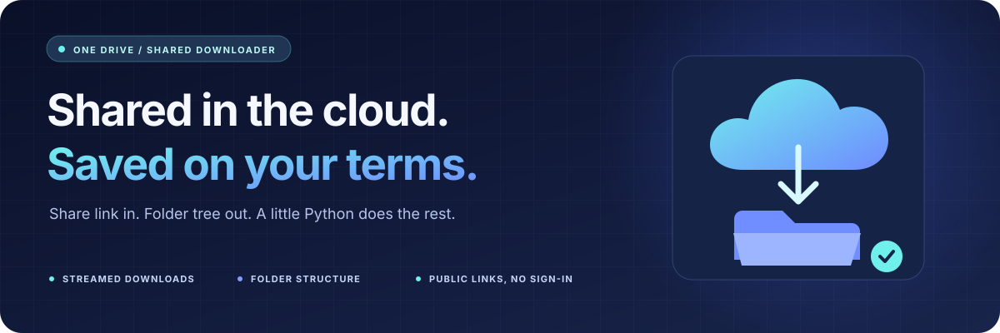

  

<h1 align="center">☁️ OneDrive Shared Downloader</h1>

  <strong>Turn a shared OneDrive link into local files—with the folder tree intact.</strong> 
  Concurrent downloads. Small memory footprint. No account sign-in for public personal shares.

  
  
  
  

  <a href="#-quick-start">Quick start</a> ·
  <a href="#-usage">Usage</a> ·
  <a href="#-python-api">Python API</a> ·
  <a href="#-how-it-works">How it works</a> ·
  <a href="#-tests--verification">Verification</a>

---

## ✨ What you get

| | Feature | What it means |
|---|---|---|
| ⚡ | Concurrent transfers | Download up to five files at once by default; adjust with `--concurrent`. |
| 🗂️ | Preserved structure | Keep the shared root name, nested directories, and empty folders. |
| 🌊 | Streamed downloads | Write chunks to disk instead of loading whole files into RAM. |
| 🔎 | Preview and selection | List paths and sizes, or choose files with repeatable glob filters. |
| ✅ | Complete files only | Check HTTP status and expected size before replacing the destination file. |
| ☁️ | Current public-share support | Automatically obtain an anonymous guest session for migrated personal drives. |
| 🐍 | CLI and Python API | Run a command, call `download()`, or await `download_async()`. |

## 🚀 Quick start

**Requires Python 3.10 or newer.** Start with a new virtual environment.

~~~bash
git clone https://github.com/1Suryansh7/one-drive-shared-downloader.git
cd one-drive-shared-downloader
python -m venv .venv
~~~

**Windows / PowerShell**

~~~powershell
.\.venv\Scripts\python.exe -m pip install -r requirements.txt
.\.venv\Scripts\python.exe onedrive.py "YOUR_SHARED_LINK" --output Downloads
~~~

<strong>macOS / Linux</strong>

~~~bash
./.venv/bin/python -m pip install -r requirements.txt
./.venv/bin/python onedrive.py "YOUR_SHARED_LINK" --output Downloads
~~~

If your system exposes Python as `python3`, use `python3 -m venv .venv` when
creating the environment.

> **Upgrading from the original project?** Use a fresh environment. Its old
> HTTPX / Trio dependencies are incompatible with modern Python.

## 🛠️ Usage

The examples below assume your virtual environment is active. Alternatively,
replace `python` with the virtual environment's Python executable shown above.

~~~bash
# Download the entire shared item
python onedrive.py "YOUR_SHARED_LINK" --output Downloads

# Inspect paths and byte sizes; no files or directories are created
python onedrive.py "YOUR_SHARED_LINK" --list

# Choose files with glob patterns
python onedrive.py "YOUR_SHARED_LINK" --output Downloads --include "*.pdf"

# Combine filters and increase concurrency
python onedrive.py "YOUR_SHARED_LINK" -o Downloads -j 10 \
  --include "*.pdf" --include "*.txt"
~~~

The final example uses a Bash line continuation; in PowerShell, put the command
on a single line.

| Option | Default | Purpose |
|---|---|---|
| `-o`, `--output` | Current directory | Set the destination folder. |
| `-j`, `--concurrent` | `5` | Limit simultaneous file transfers. |
| `--include` | All files | Match a filename or relative path; repeat for multiple patterns. |
| `--list` | Off | Preview matching paths and sizes without writing files. |
| `-h`, `--help` | — | Display command help. |

Patterns match paths such as `Shared folder/Subfolder/report.pdf` or just a
basename such as `report.pdf`. Full downloads preserve empty folders; selective
downloads create the directories needed by the selected files.

<strong>Try a small, real public download</strong>

The original project's public example is a folder of roughly **1.9 GB**.
This command selects just one **61,882-byte PNG**:

~~~bash
python onedrive.py "https://1drv.ms/u/s!AtZI6E5G7ZC_izG2o7OFNjh2N0Yk?e=hjDg8t" --output Downloads --include "1540908626811.png"
~~~

~~~text
Traversing directory tree..
Found 1 files, downloading..
Download progress: 1/1 (100.00%)
~~~

~~~text
Downloads/
└── Wallpaper/
    └── 1540908626811.png
~~~

This link belongs to the original project author and may change.

## 🐍 Python API

The original import and calling convention still work:

~~~python
from onedrive import OneDriveSharedFolder

downloader = OneDriveSharedFolder("YOUR_SHARED_LINK")
downloader.download(path="Downloads", concurrent_reqs=5)

# Optional: preview or select files
downloader.download(dry_run=True)
downloader.download(path="Downloads", include=["*.pdf", "*.txt"])
~~~

Already inside an event loop?

~~~python
await downloader.download_async(path="Downloads", concurrent_reqs=5)
~~~

## 🔄 How it works

~~~text
Sharing link
     │
     ├── Original OneDrive API
     │      └── Public migrated drive? Obtain an anonymous guest session.
     │
     ├── Resolve items → walk subfolders → follow pagination
     │
     └── Signed download URLs → temporary files → verified local files
~~~

The downloader retains the root share's permission context while traversing
nested folders. Download bodies are streamed in chunks, and temporary files are
removed after failures or interruptions. Existing destination files are replaced
only after a complete successful transfer.

## 🔐 Protected links and SharePoint

Public personal OneDrive links do not require an account sign-in.
Links requiring a password, email verification, or account access remain
protected, and owner download restrictions still apply.

For protected links and Business / SharePoint, provide an already authorized
Microsoft Graph access token. The CLI reads `ONEDRIVE_ACCESS_TOKEN` from the
environment; Python callers can pass it explicitly:

~~~python
downloader = OneDriveSharedFolder(
    "YOUR_ONEDRIVE_OR_SHAREPOINT_LINK",
    access_token=authorized_graph_token,
)
downloader.download(path="Downloads")
~~~

The token's permissions and account access must match the shared item.
See [Microsoft's shared-item API documentation](https://learn.microsoft.com/en-us/graph/api/shares-get?view=graph-rest-1.0).
There is no interactive sign-in flow.

## 🧪 Tests & verification

~~~bash
python -m unittest -v
~~~

**16 offline regression tests** cover file and folder downloads, pagination,
guest sessions, Graph tokens, redirects, path handling, concurrency limits, and
interrupted transfers. No credentials or network access are needed to run them.
GitHub Actions runs the suite on **Windows and Ubuntu**, with **Python 3.10 and 3.13**.

A real file was also downloaded from the public example share and verified as a
**61,882-byte, 1920 × 1080 PNG**. Details and its SHA-256 are recorded in
[VALIDATION.md](VALIDATION.md).

The authenticated Graph route has been tested with mocked responses; it has not
been verified with a real account here. Anonymous guest endpoints are not a
documented Microsoft Graph contract and can change.

## 🤝 Credits

Built from [py-radicz/onedrive-sharedfolder-download](https://github.com/py-radicz/onedrive-sharedfolder-download),
with its original Git history retained. This version modernizes the runtime,
repairs current public-share downloads, and adds a CLI and regression tests.

Guest-session protocol references:
[the OneDrive-link discussion](https://github.com/felixrieseberg/onedrive-link/issues/1)
and [rclone's OneDrive migration discussion](https://github.com/rclone/rclone/issues/7898).

---

  Built for the moment when “shared with you” needs to become “saved by you.” ☁️ → 📁

